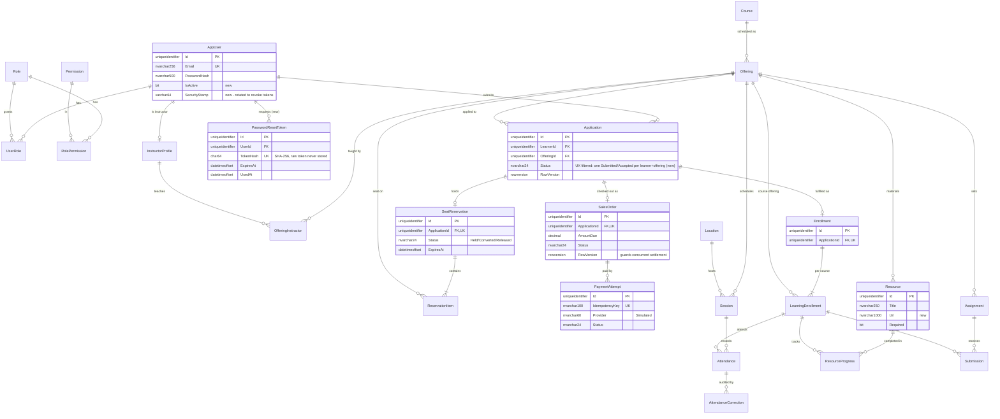

# ERD v3 / v4 — Identity, Admissions, Payments, Learning

Scope: the tables exercised by Sprints 3 and 4. The full 56-table model is in the migrations.
Migration `20261021184047_Sprint3And4IdentityAdmissionsLearning` adds the items marked **(new)**.

Seeded reference data (fixed GUIDs, `Data/Seed/IdentitySeedData.cs`): 4 roles, 13 permissions, 18 role-permission grants.
